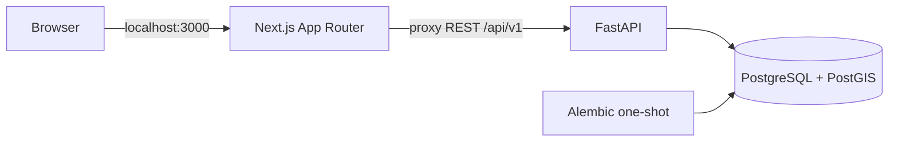

# Architecture

AssetVision IT adalah modular monolith lokal. Satu API FastAPI memiliki logika bisnis dan otorisasi,
satu Next.js menyajikan UI, dan PostgreSQL/PostGIS menjadi sumber kebenaran.
Tidak ada Redis, worker queue, AI, OCR, kamera, atau dependensi cloud.

## Batas tanggung jawab

- apps/api/app/config.py memvalidasi konfigurasi dan menyembunyikan input rahasia pada pesan kesalahan.
- db.py menyediakan session SQLAlchemy per request, tanpa auto-create schema.
- models.py mendefinisikan pengguna, sesi, dan audit serta mendaftarkan seluruh metadata domain.
- assets.py mendefinisikan unit fisik, klaim identifier, dan snapshot audit metadata (1B-01).
  Alembic 0004 menambahkan tabel dan trigger pelindung identitas/retensi, tanpa mengubah tabel lama.
  asset_routes.py/asset_schemas.py/asset_service.py (1B-02) menyediakan API unit/identifier,
  RBAC dan validasi, memakai autentikasi/CSRF existing. Lock unit induk + version client/ORM
  mencegah mutasi metadata dan identifier saling menimpa. Snapshot before/after disimpan
  dalam transaksi yang sama dengan domain; gagal audit menggagalkan mutasi.
  Proxy existing hanya membuka rute/metode yang eksplisit. Seed unit belum dijalankan.
- asset_csv.py/asset_csv_schemas.py/asset_csv_routes.py (1B-03) menambahkan parser dan API CSV
  ADMIN. Preview tidak menulis DB. Commit memvalidasi ulang payload, mengunci referensi model,
  dan membuat seluruh unit/identifier/audit/receipt dalam satu transaksi batch. Kegagalan
  me-rollback seluruh batch. Ledger asset_import_batches menyimpan digest, aktor, hasil,
  dan location_hint staging; tidak menyimpan CSV mentah atau mengubah lokasi aset.
  Migration 0005 hanya menambah ledger. Idempotency memakai unique UUID database, tanpa
  cache proses/Redis. CsvRoute membatasi stream JSON 1 MiB sebelum parsing; proxy memakai
  ceiling sama hanya pada dua route impor. Batas CRUD/foto existing dipertahankan.
  Export menggunakan filter aset existing, formula-safe CSV dan JSON seluruh klaim aktif.
- catalog.py mendefinisikan kategori, manufacturer, model perangkat, dan metadata foto referensi
  (Sprint 1A-01). Model katalog didaftarkan melalui models.py agar metadata Alembic tetap satu.
  seed_catalog.py menyediakan seed katalog sintetis eksplisit.
- catalog_routes.py, catalog_schemas.py, dan catalog_service.py menyediakan CRUD API Sprint 1A-02:
  RBAC server-side, validasi bounded JSON, filtering/pagination, version client + ORM,
  dan audit transaksional. Tidak ada endpoint penghapusan fisik master katalog.
- security.py menangani Argon2id, JWT HS256, cookie, dan signed double-submit CSRF.
- image_routes.py/image_validation.py/image_service.py menyediakan upload/list/content/delete
  foto berautentikasi. storage.py menyediakan StorageProvider dan LocalStorageProvider.
  File privat di volume reference_images terpisah dari metadata PostgreSQL.
  storage_cleanup_jobs menyimpan intent cleanup durable; retry melalui storage_cleanup.py,
  tanpa worker/service baru atau pemindaian/penghapusan file lain.
- dependencies.py memeriksa token, sesi DB, status pengguna, serta peran terkini.
  APIKeyCookie mendeklarasikan kontrak OpenAPI tanpa mengganti validasi JWT/sesi atau status 401.
  openapi.py mendokumentasikan header CSRF/Origin serta batas penggunaan cookie dan pagination.
- routes.py menyediakan kontrak REST; bootstrap.py adalah entry point CLI terpisah.
- apps/web/lib/proxy.ts hanya meneruskan endpoint yang diizinkan, metode, dan header yang dibutuhkan.
  Cookie Set-Cookie diteruskan satu per satu, tanpa mengirim JWT ke JavaScript.
- Dashboard melakukan pemeriksaan autentikasi server-side melalui /auth/me. Otorisasi API selalu dilakukan kembali oleh backend.

## Sesi dan keamanan

JWT berisi sub (UUID pengguna), jti (UUID sesi), iat, exp, issuer, dan audience.
Masa berlaku default 15 menit, tanpa refresh. Cookie host-only av_access dan av_csrf memakai
HttpOnly, SameSite=Lax, Path=/; Secure diaktifkan untuk HTTPS.
Server menyimpan hash token CSRF pada sesi. Logout mencabut sesi di database sehingga replay JWT ditolak.
Penonaktifan akun dan perubahan peran berlaku pada permintaan selanjutnya.

Sebelum login, browser meminta /auth/csrf. Semua metode perubahan data memerlukan Origin yang
diizinkan dan X-CSRF-Token yang cocok dengan cookie serta signature HMAC. Setelah login token
dirotasi dan diikat ke sesi; /auth/session menyediakan token sesi bagi aksi logout. Bootstrap CSRF mempertahankan cookie valid yang sudah ada, dan input non-ASCII ditolak 403. Proxy membatasi body CRUD menjadi 16 KiB saat membacanya sebagai stream; upload gambar memiliki ceiling 8 MiB + 64 KiB overhead.
Tidak ada CORS lintas origin; browser menggunakan BFF satu origin.

Audit database menyimpan bootstrap, login berhasil/gagal, logout, serta create/update/archive katalog
tanpa password/token. Audit katalog berisi actor, tabel, UUID record, action, version, dan timestamp;
belum menyimpan diff/snapshot lengkap field domain.
Log aplikasi berformat JSON berisi request ID, template route, metode, status, dan durasi.
Body, query string, cookie, authorization header, parameter SQL, serta stack exception tidak dicetak.
Error validasi tidak mengembalikan input password.

## Operasi

UI katalog berada di App Router `/catalog`: layout server memeriksa sesi dan memasok role
ke komponen client. Halaman tambah dan pengaturan juga memeriksa ADMIN di server.
Komponen memakai proxy same-origin existing; mutasi mengambil CSRF sesi dari `/auth/session`.
JWT tidak dibaca JavaScript atau disimpan di localStorage. API tetap pemegang otorisasi bisnis.
Form menyimpan version saat mulai edit; background refresh tidak menaikkan version draft.
Konflik 409 tidak memicu retry otomatis atau menimpa isian. Upload multi-file berjalan berurutan
dengan model_version terbaru dari setiap response; kegagalan parsial tetap terlihat.
Foto memakai content_url privat dengan cookie sesi, tanpa Next image optimization/cache publik.
Tidak ada perubahan skema atau layanan runtime baru untuk frontend ini.

UI registry Task 1B-04 memakai `/assets`, `/assets/new`, `/assets/{id}` dan `/assets/import`.
Layout server memakai getCurrentUser dan provider role existing; halaman tambah/impor memiliki
guard ADMIN server-side. Komponen memakai proxy same-origin dan session CSRF yang sama dengan
katalog. Form menyimpan version awal dan mempertahankan isian pada konflik; tidak mengirim ulang
mutasi otomatis. CRUD unit dan klaim tetap merupakan request terpisah: unit tanpa SN boleh dibuat,
lalu klaim ditambahkan di detail. Detail mengunci aksi edit metadata/identifier agar tidak saling
menimpa draft lokal. Backend version tetap menjadi penjaga final terhadap writer lain.

Endpoint GET `/assets/{id}/events` ditambahkan untuk detail riwayat: authenticated read-only,
pagination bounded, filter asset wajib, sort waktu desc/version snapshot desc/UUID desc.
Tidak menambah tabel/migration atau mekanisme audit baru. Snapshot dan actor UUID dibaca dari
asset_change_events existing; tidak membuka user/email/password/session atau mutation audit API.
Komponen riwayat menampilkan snapshot sebelum/sesudah yang dapat dibuka per event.

File CSV dibaca lokal dengan decoder UTF-8 strict dan batas byte sebelum dikirim menjadi JSON.
Preview dibatalkan saat file berubah. Commit membuat UUID dan menyimpan request immutable di
state halaman; hasil tidak pasti hanya dapat diulang dengan CSV/key/flag yang sama. Tidak ada
retry otomatis atau penyimpanan CSV/secret di localStorage. Setelah navigasi/reload state hilang;
pengguna diminta memastikan hasil sebelum memulai batch lain. Receipt server tetap persisten.
Foto unit opsional, lokasi/movement dan seed delapan AP tidak ditambahkan pada slice ini.

Database hanya berada di network internal. API dan web hanya bind host 127.0.0.1.
Migrasi harus selesai sebelum API berjalan; web menunggu readiness API.
Health memeriksa proses; readiness memeriksa koneksi DB, PostGIS, versi migrasi, serta tabel yang diperlukan.
Tidak ada perubahan skema otomatis selain Alembic yang dieksekusi eksplisit oleh layanan migrate.
Revisi 0003_image_cleanup menambah tabel intent tanpa mengubah data katalog existing.
Upload mereservasi intent sebelum menulis bytes dan menghapus intent dalam transaksi metadata/audit.
Delete menghapus metadata dan membuat intent dalam satu transaksi, lalu mencoba unlink.
Jika unlink gagal, konten tidak lagi dapat diakses lewat API; retry CLI menyelesaikannya.
Lock model menjaga batas foto, primary, dan version saat mutasi bersamaan.

Mutasi katalog mewajibkan version dari client dan pemeriksaan SQLAlchemy version counter,
dengan audit dalam transaksi yang sama. Modul domain berikutnya harus mempertahankan pola ini.
Interface AI/OCR/storage diperkenalkan
saat fiturnya dibutuhkan, tanpa dependensi inference pada fondasi ini.
