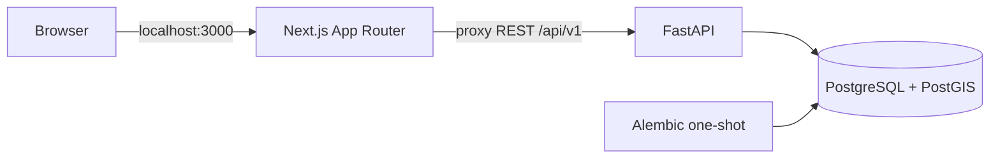

# Architecture

AssetVision IT adalah modular monolith lokal. Satu API FastAPI memiliki logika bisnis dan otorisasi,
satu Next.js menyajikan UI, dan PostgreSQL/PostGIS menjadi sumber kebenaran.
Tidak ada Redis, worker queue, AI, OCR, kamera, atau dependensi cloud.

## Batas tanggung jawab

- apps/api/app/config.py memvalidasi konfigurasi dan menyembunyikan input rahasia pada pesan kesalahan.
- db.py menyediakan session SQLAlchemy per request, tanpa auto-create schema.
- models.py mendefinisikan pengguna, sesi, dan audit; belum ada entitas aset.
- security.py menangani Argon2id, JWT HS256, cookie, dan signed double-submit CSRF.
- dependencies.py memeriksa token, sesi DB, status pengguna, serta peran terkini.
- routes.py menyediakan kontrak REST; bootstrap.py adalah entry point CLI terpisah.
- apps/web/lib/proxy.ts hanya meneruskan endpoint yang diizinkan, metode, dan header yang dibutuhkan.
  Cookie Set-Cookie diteruskan satu per satu, tanpa mengirim JWT ke JavaScript.
- Dashboard melakukan pemeriksaan autentikasi server-side melalui /auth/me. Otorisasi API selalu dilakukan kembali oleh backend.

## Sesi dan keamanan

JWT berisi sub (UUID pengguna), jti (UUID sesi), iat, exp, issuer, dan audience.
Masa berlaku default 15 menit, tanpa refresh. Cookie host-only av_access dan av_csrf memakai
HttpOnly, SameSite=Lax, Path=/; Secure diaktifkan untuk HTTPS.
Server menyimpan hash token CSRF pada sesi. Logout mencabut sesi di database sehingga replay JWT ditolak.
Penonaktifan akun dan perubahan peran berlaku pada permintaan selanjutnya.

Sebelum login, browser meminta /auth/csrf. Semua metode perubahan data memerlukan Origin yang
diizinkan dan X-CSRF-Token yang cocok dengan cookie serta signature HMAC. Setelah login token
dirotasi dan diikat ke sesi; /auth/session menyediakan token sesi bagi aksi logout. Bootstrap CSRF mempertahankan cookie valid yang sudah ada, dan input non-ASCII ditolak 403. Proxy membatasi body POST menjadi 16 KiB saat membacanya sebagai stream.
Tidak ada CORS lintas origin; browser menggunakan BFF satu origin.

Audit database menyimpan bootstrap, login berhasil/gagal, dan logout tanpa password/token.
Log aplikasi berformat JSON berisi request ID, template route, metode, status, dan durasi.
Body, query string, cookie, authorization header, parameter SQL, serta stack exception tidak dicetak.
Error validasi tidak mengembalikan input password.

## Operasi

Database hanya berada di network internal. API dan web hanya bind host 127.0.0.1.
Migrasi harus selesai sebelum API berjalan; web menunggu readiness API.
Health memeriksa proses; readiness memeriksa koneksi DB, PostGIS, versi migrasi, serta tabel yang diperlukan.
Tidak ada perubahan skema otomatis selain Alembic yang dieksekusi eksplisit oleh layanan migrate.

Perubahan data domain pada sprint selanjutnya harus membawa aturan optimistic concurrency
dan audit transaksi sebelum endpoint mutasi ditambahkan. Interface AI/OCR/storage diperkenalkan
saat fiturnya dibutuhkan, tanpa dependensi inference pada fondasi ini.
