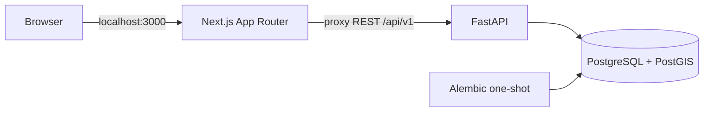

# Architecture

## Location hierarchy — Task 2-01

`locations.py` mendaftarkan model pada metadata existing; `location_schemas.py`,
`location_service.py` dan `location_routes.py` menambahkan API tanpa sistem auth/audit baru.
Migration 0006 hanya membuat tabel/index/trigger lokasi; tidak mengubah tabel aset atau
memetakan hint CSV. Pada 2-01 readiness mensyaratkan revisi 0006 dan tabel locations; head kini 0009 (2-04).
Tree memakai adjacency list (`id`, `parent_id`) agar tidak bergantung kedalaman JSON.
Maksimum 5000 node; kelebihan ditolak eksplisit, gunakan daftar paginated.

Mutasi hierarki PostgreSQL memakai satu transaction advisory lock sebelum membaca parent/
version, lalu validasi ancestor dan commit bersama snapshot audit. Ini menserialisasi
perubahan lintas node agar dua reparent tidak bersama-sama membentuk cycle. Trigger memakai
lock sama dan recursive CTE UNION untuk melindungi SQL langsung, termasuk cycle lintas node;
UUID immutable dan DELETE ditolak. SQLite memakai trigger CTE dan unique/check constraints,
sedangkan pengujian race multi-session memakai PostgreSQL sebagai sumber kebenaran.
API berjalan dengan isolation READ COMMITTED existing. Semua lokasi tetap dapat dibaca
setelah arsip. Tidak ada self-approval/movement policy pada task ini.

Koordinat outdoor opsional berupa latitude/longitude berpasangan, akurasi meter dan waktu
pengambilan timezone-aware. Bukan identitas aset atau lokasi authoritative. Floorplan,
upload dan pin indoor ditunda bersama fitur opsionalnya; input tersebut belum diterima API.
Frontend hanya menambah allowlist proxy API; location tree UI berada pada Task 2-05.

AssetVision IT adalah modular monolith lokal. Satu API FastAPI memiliki logika bisnis dan otorisasi,
satu Next.js menyajikan UI, dan PostgreSQL/PostGIS menjadi sumber kebenaran.
Tidak ada Redis, worker queue, OCR, kamera, atau dependensi cloud wajib. API default tidak
memuat dependensi inference; encoder CPU opsional Task3-02 berjalan pada image terpisah.

## Batas tanggung jawab

- apps/api/app/config.py memvalidasi konfigurasi dan menyembunyikan input rahasia pada pesan kesalahan.
- db.py menyediakan session SQLAlchemy per request, tanpa auto-create schema.
- models.py mendefinisikan pengguna, sesi, dan audit serta mendaftarkan seluruh metadata domain.
- assets.py mendefinisikan unit fisik, klaim identifier, dan snapshot audit metadata (1B-01).
  Alembic 0004 menambahkan tabel dan trigger pelindung identitas/retensi, tanpa mengubah tabel lama.
  asset_routes.py/asset_schemas.py/asset_service.py (1B-02) menyediakan API unit/identifier,
  RBAC dan validasi, memakai autentikasi/CSRF existing. Lock unit induk + version client/ORM
  mencegah mutasi metadata dan identifier saling menimpa. Snapshot before/after disimpan
  dalam transaksi yang sama dengan domain; gagal audit menggagalkan mutasi.
  Proxy existing hanya membuka rute/metode yang eksplisit. Seed unit belum dijalankan.
- asset_csv.py/asset_csv_schemas.py/asset_csv_routes.py (1B-03) menambahkan parser dan API CSV
  ADMIN. Preview tidak menulis DB. Commit memvalidasi ulang payload, mengunci referensi model,
  dan membuat seluruh unit/identifier/audit/receipt dalam satu transaksi batch. Kegagalan
  me-rollback seluruh batch. Ledger asset_import_batches menyimpan digest, aktor, hasil,
  dan location_hint staging; tidak menyimpan CSV mentah atau mengubah lokasi aset.
  Migration 0005 hanya menambah ledger. Idempotency memakai unique UUID database, tanpa
  cache proses/Redis. CsvRoute membatasi stream JSON 1 MiB sebelum parsing; proxy memakai
  ceiling sama hanya pada dua route impor. Batas CRUD/foto existing dipertahankan.
  Export menggunakan filter aset existing, formula-safe CSV dan JSON seluruh klaim aktif.
- catalog.py mendefinisikan kategori, manufacturer, model perangkat, dan metadata foto referensi
  (Sprint 1A-01). Model katalog didaftarkan melalui models.py agar metadata Alembic tetap satu.
  seed_catalog.py menyediakan seed katalog sintetis eksplisit.
  seed_assets.py (1B-05) adalah CLI development/test dengan aktor ADMIN aktif dan konfirmasi
  eksplisit. Satu transaksi membuat referensi katalog yang hilang, delapan unit sintetis,
  klaim dan snapshot audit memakai writer audit existing. Tidak memanggil service per-record
  yang commit sendiri. Advisory lock PostgreSQL menserialisasi seed; row lock melindungi
  aktor/referensi. UUID unit deterministik + CREATE snapshot marker membedakan batch milik
  seed dari data existing. Tidak ada upsert, repair, auto-seed atau migration baru.
- catalog_routes.py, catalog_schemas.py, dan catalog_service.py menyediakan CRUD API Sprint 1A-02:
  RBAC server-side, validasi bounded JSON, filtering/pagination, version client + ORM,
  dan audit transaksional. Tidak ada endpoint penghapusan fisik master katalog.
- security.py menangani Argon2id, JWT HS256, cookie, dan signed double-submit CSRF.
- image_routes.py/image_validation.py/image_service.py menyediakan upload/list/content/delete
  foto berautentikasi. storage.py menyediakan StorageProvider dan LocalStorageProvider.
  File privat di volume reference_images terpisah dari metadata PostgreSQL.
  storage_cleanup_jobs menyimpan intent cleanup durable; retry melalui storage_cleanup.py,
  tanpa worker/service baru atau pemindaian/penghapusan file lain.
- dependencies.py memeriksa token, sesi DB, status pengguna, serta peran terkini.
  APIKeyCookie mendeklarasikan kontrak OpenAPI tanpa mengganti validasi JWT/sesi atau status 401.
  openapi.py mendokumentasikan header CSRF/Origin serta batas penggunaan cookie dan pagination.
- routes.py menyediakan kontrak REST; bootstrap.py adalah entry point CLI terpisah.
- apps/web/lib/proxy.ts hanya meneruskan endpoint yang diizinkan, metode, dan header yang dibutuhkan.
  Cookie Set-Cookie diteruskan satu per satu, tanpa mengirim JWT ke JavaScript.
- Dashboard melakukan pemeriksaan autentikasi server-side melalui /auth/me. Otorisasi API selalu dilakukan kembali oleh backend.

## Sesi dan keamanan

JWT berisi sub (UUID pengguna), jti (UUID sesi), iat, exp, issuer, dan audience.
Masa berlaku default 15 menit, tanpa refresh. Cookie host-only av_access dan av_csrf memakai
HttpOnly, SameSite=Lax, Path=/; Secure diaktifkan untuk HTTPS.
Server menyimpan hash token CSRF pada sesi. Logout mencabut sesi di database sehingga replay JWT ditolak.
Penonaktifan akun dan perubahan peran berlaku pada permintaan selanjutnya.

Sebelum login, browser meminta /auth/csrf. Semua metode perubahan data memerlukan Origin yang
diizinkan dan X-CSRF-Token yang cocok dengan cookie serta signature HMAC. Setelah login token
dirotasi dan diikat ke sesi; /auth/session menyediakan token sesi bagi aksi logout. Bootstrap CSRF mempertahankan cookie valid yang sudah ada, dan input non-ASCII ditolak 403. Proxy membatasi body CRUD menjadi 16 KiB saat membacanya sebagai stream; upload gambar memiliki ceiling 8 MiB + 64 KiB overhead.
Tidak ada CORS lintas origin; browser menggunakan BFF satu origin.

Audit database menyimpan bootstrap, login berhasil/gagal, logout, serta create/update/archive katalog
tanpa password/token. Audit katalog berisi actor, tabel, UUID record, action, version, dan timestamp;
belum menyimpan diff/snapshot lengkap field domain.
Log aplikasi berformat JSON berisi request ID, template route, metode, status, dan durasi.
Body, query string, cookie, authorization header, parameter SQL, serta stack exception tidak dicetak.
Error validasi tidak mengembalikan input password.

## Operasi

UI katalog berada di App Router `/catalog`: layout server memeriksa sesi dan memasok role
ke komponen client. Halaman tambah dan pengaturan juga memeriksa ADMIN di server.
Komponen memakai proxy same-origin existing; mutasi mengambil CSRF sesi dari `/auth/session`.
JWT tidak dibaca JavaScript atau disimpan di localStorage. API tetap pemegang otorisasi bisnis.
Form menyimpan version saat mulai edit; background refresh tidak menaikkan version draft.
Konflik 409 tidak memicu retry otomatis atau menimpa isian. Upload multi-file berjalan berurutan
dengan model_version terbaru dari setiap response; kegagalan parsial tetap terlihat.
Foto memakai content_url privat dengan cookie sesi, tanpa Next image optimization/cache publik.
Tidak ada perubahan skema atau layanan runtime baru untuk frontend ini.

UI registry Task 1B-04 memakai `/assets`, `/assets/new`, `/assets/{id}` dan `/assets/import`.
Layout server memakai getCurrentUser dan provider role existing; halaman tambah/impor memiliki
guard ADMIN server-side. Komponen memakai proxy same-origin dan session CSRF yang sama dengan
katalog. Form menyimpan version awal dan mempertahankan isian pada konflik; tidak mengirim ulang
mutasi otomatis. CRUD unit dan klaim tetap merupakan request terpisah: unit tanpa SN boleh dibuat,
lalu klaim ditambahkan di detail. Detail mengunci aksi edit metadata/identifier agar tidak saling
menimpa draft lokal. Backend version tetap menjadi penjaga final terhadap writer lain.

Endpoint GET `/assets/{id}/events` ditambahkan untuk detail riwayat: authenticated read-only,
pagination bounded, filter asset wajib, sort waktu desc/version snapshot desc/UUID desc.
Tidak menambah tabel/migration atau mekanisme audit baru. Snapshot dan actor UUID dibaca dari
asset_change_events existing; tidak membuka user/email/password/session atau mutation audit API.
Komponen riwayat menampilkan snapshot sebelum/sesudah yang dapat dibuka per event.

File CSV dibaca lokal dengan decoder UTF-8 strict dan batas byte sebelum dikirim menjadi JSON.
Preview dibatalkan saat file berubah. Commit membuat UUID dan menyimpan request immutable di
state halaman; hasil tidak pasti hanya dapat diulang dengan CSV/key/flag yang sama. Tidak ada
retry otomatis atau penyimpanan CSV/secret di localStorage. Setelah navigasi/reload state hilang;
pengguna diminta memastikan hasil sebelum memulai batch lain. Receipt server tetap persisten.
Foto unit opsional, lokasi/movement dan seed delapan AP tidak ditambahkan pada slice ini.

Hardening 1B-05 mempertahankan kontrak UI/API: respons sukses mutasi yang bukan objek JSON
dianggap hasil tidak pasti, tidak memicu sukses palsu atau retry create otomatis.
Pembuatan UUID impor berada di try/finally agar error browser tidak meninggalkan form terkunci.
Listener beforeunload dipasang selama commit belum pasti dan dilepas sesudah sukses/ditolak.
Ini peringatan browser yang bersifat best-effort, bukan penyimpanan request tahan reload;
CSV/key tetap di memori halaman dan retry tetap memakai payload persis sama.

Database hanya berada di network internal. API dan web hanya bind host 127.0.0.1.
Migrasi harus selesai sebelum API berjalan; web menunggu readiness API.
Health memeriksa proses; readiness memeriksa koneksi DB, PostGIS, versi migrasi, serta tabel yang diperlukan.
Tidak ada perubahan skema otomatis selain Alembic yang dieksekusi eksplisit oleh layanan migrate.
Revisi 0003_image_cleanup menambah tabel intent tanpa mengubah data katalog existing.
Upload mereservasi intent sebelum menulis bytes dan menghapus intent dalam transaksi metadata/audit.
Delete menghapus metadata dan membuat intent dalam satu transaksi, lalu mencoba unlink.
Jika unlink gagal, konten tidak lagi dapat diakses lewat API; retry CLI menyelesaikannya.
Lock model menjaga batas foto, primary, dan version saat mutasi bersamaan.

Mutasi katalog mewajibkan version dari client dan pemeriksaan SQLAlchemy version counter,
dengan audit dalam transaksi yang sama. Modul domain berikutnya harus mempertahankan pola ini.
Interface AI/OCR/storage diperkenalkan
saat fiturnya dibutuhkan, tanpa dependensi inference pada fondasi ini.

## Initial asset location — Task 2-02

asset_location_routes/service memakai auth/CSRF, session, row lock aset, version dan
transaction helper existing. Urutan lock: hierarchy advisory lock → row lock aset → baca
tujuan; mutasi hierarchy dan penempatan tidak berlomba terhadap is_active tujuan. ORM
version membatasi lost update bersama perubahan metadata/identifier. Satu transaksi menulis
current_location_id, location_verified_at, version dan AssetLocationEvent di asset_events.
Event domain lokasi terpisah dari asset_change_events snapshot metadata existing; tidak
mengubah payload historis lama. Payload menyimpan asal null, tujuan UUID/snapshot lokasi,
alasan, expected/new asset version, effective_at dan keputusan ADMIN. Aktor, occurred_at,
recorded_at dan correlation_id tersimpan sebagai kolom. Trigger history existing melarang
UPDATE/DELETE event juga pada SQL langsung, bukan perlindungan terhadap database owner.
Tidak ada service baru, UI atau movement state machine pada task ini.

## Movement transactions — Task 2-03

movements.py mendaftarkan AssetMovement pada metadata existing. movement_schemas/routes/
service memakai auth/CSRF, Page helper dan transaksi asset_service existing. Request mengunci
hierarchy lalu asset; keputusan mengunci hierarchy → movement → asset, semuanya sampai
commit. Lock hierarchy existing menserialisasi eligibility tujuan dengan archive/reparent;
row lock/populate_existing dan version ORM melindungi metadata/identifier/approval concurrent.
Tidak ada writer aplikasi yang mengunci aset lalu mengambil hierarchy lock.

Request tidak menaikkan asset version. Decision approve membandingkan origin dan versi
snapshot request; metadata/identifier edit juga membuat approval stale. Reject/cancel hanya
menutup request dengan event atomik; stale asset tidak menghalangi closure tanpa mutasi aset.
Semua transisi menulis AssetLocationEvent existing, dengan movement_id, request/decision,
aktor, waktu, correlation UUID baru, asset version serta policy/flag self-approval. Snapshot
lokasi saat request dan saat approval menjaga konteks historis. DB trigger mempertahankan
request immutable, terminal final, start PENDING/version1 dan melarang DELETE. FK/check
constraints menolak orphan dan kombinasi status/timestamp tidak konsisten. SQL owner tetap
harus memenuhi RBAC/atomic audit melalui aplikasi; guards bukan proteksi terhadap superuser.

Pilot mengizinkan ADMIN approve request sendiri dengan pencatatan eksplisit, sehingga satu
ADMIN lokal dapat bekerja. Tidak menambah akun, config, dependency atau service infrastruktur.
Migration 0008 hanya membuat tabel/index/check/trigger baru kosong; readiness pada 2-03 head 0008.
Timeline/observasi API dilanjutkan pada Task 2-04 di bawah; UI tetap Task 2-05.

## Timeline dan observasi — Task 2-04

Modul observations/observation_schemas/service/routes memakai auth, bounded body, Page,
transaction helper dan advisory hierarchy lock existing. Create mengunci hierarchy → aset
jika linked; review hierarchy → observation → aset. Asset lock/version memastikan snapshot
resmi konsisten dengan approval/metadata, tanpa increment atau mutasi master oleh evidence.
Event LOCATION_OBSERVED/LOCATION_OBSERVATION_REVIEWED dan evidence/decision commit atomik;
kegagalan audit me-rollback keseluruhan. Unlinked memakai AuditEvent existing karena
asset_events mensyaratkan asset_id; tidak membuat aset palsu atau menebak identitas.

location_status membaca aset dan latest non-dismissed observation dalam satu SELECT untuk
snapshot konsisten. Status dihitung saat GET tanpa write, bukti sebelum waktu verifikasi
resmi diberi STALE_OBSERVATION. ACK bukan resolusi; DISMISS tidak menghapus bukti. Evidence
immutable, satu keputusan terminal/version +1; snapshot nama/lokasi tetap setelah archive.

Timeline adalah UNION ALL read-only dua sumber event existing, dengan pagination/filter
sebelum bulk fetch payload terbatas per sumber. (source,id) membedakan UUID yang sama.
Tidak menyalin event lama, mengubah precision timestamp lama atau menambah service/event bus.
Migration 0009 membuat tabel/index/check/guard kosong; readiness memerlukan head 0009 dan
tabel observasi. Proxy hanya mengizinkan method/route domain tersebut. UI/UAT tetap 2-05.

## Frontend Sprint 2 — Task 2-05

`lib/locations.ts` berisi DTO, label, traversal adjacency iteratif dan writer domain berbatas.
Komponen locations memakai CatalogProvider/useCatalogResource/auth/CSRF/proxy existing.
Context user UUID ditambahkan opsional dari server untuk visibilitas cancel sendiri; bukan
authority bisnis baru. Assets layout yang terautentikasi dipakai ulang oleh lokasi/inbox;
server page inbox menolak non-ADMIN. Error/loading boundary dan CSS responsive mengikuti shell.

Location manager menyediakan form create/edit/arsip dengan snapshot version. AssetLocation
menghubungkan official status, penempatan/request/observasi, movement history, observation
review dan timeline. Metadata/identifier editing serta formulir placement/request/observasi
saling menonaktifkan kontrol tulis terkait agar draft tidak terganti karena refresh lokal.
MovementList/Decision dipakai di detail aset dan inbox. Sebelum keputusan, current asset dan
lima event terbaru wajib berhasil dimuat; snapshot request dan current origin/version terlihat.

WriteForm memakai synchronous in-flight guard dan busy fieldset untuk double-submit. Error
HTTP/network/malformed result membekukan submit dan menyimpan draft; pembatalan/reload eksplisit
membuka data terbaru. Tidak melakukan retry otomatis atau mengganti expected version diam-diam.
Mutasi sukses memicu pembacaan ulang, tanpa menebak lokasi/version hasil approval. Semantik
ACK/DISMISS/stale evidence dan backend authorization 2-04 dipertahankan.

Tidak mengubah business service, migration, dependencies, environment atau infrastruktur.
Floorplan/pin opsional tetap ditunda. Unknown/unlinked observations tetap tersedia lewat API;
form detail aset 2-05 hanya mencatat linked evidence, tanpa auto-link atau create unit baru.

## Offline evaluation — Task 3-01

`tools/recognition_eval` adalah CLI terpisah, tidak diimpor API. Validator memeriksa provenance,
split/group/hash, decoded/perceptual leakage dan gambar berbatas. Metrics menggunakan ranking
model cosine dan threshold calibration-only; torch_cpu.py hanya runner eksperimen, bukan
adapter/index runtime Task 3-02. Tidak ada DB, upload storage, auth atau proxy baru.

Image evaluasi mengisolasi PyTorch CPU/torchvision/NumPy dari requirements API. Download
publik library/weights eksplisit saat build. Benchmark network none, dataset/filesystem
read-only; hanya direktori laporan baru writable, proses terpisah CPU2/memory2GiB. Tidak
mount .env/volume development atau menjalankan Compose. Schema tetap0009 tanpa seed/backfill.
Protokol dan batas data sintetis/profil satu model ada di RECOGNITION_EVALUATION.md.

## Embedding generations — Task 3-02

recognition_schemas.py mendefinisikan kontrak frozen Pydantic/spec/policy/input/result.
recognition_encoder.py memisahkan Protocol, bounded decoder dan adapter PyTorch CPU lazy;
API startup tidak import torch. recognition_models.py mendaftarkan generation/index head/
image_embeddings pada Base existing. recognition_index.py mengambil catalog snapshot,
mengerjakan CPU tanpa transaksi, lalu publish lewat head lock/CAS + audit atomik. Query
read-only memverifikasi head/source/spec sebelum/sesudah CPU dan tidak mengidentifikasi aset.

Migration0010 additive: dua tabel history immutable dan singleton head. FK foto SET NULL
mempertahankan evidence saat foto dihapus; snapshot UUID/hash tetap immutable. Full rebuild
maksimum2000 eligible references; cosine stdlib fsum cukup untuk core awal tanpa menambah
NumPy runtime API. Index version menyimpan spec/preprocess/hash/policy, tidak memakai pgvector.

recognition_cli dan compose.recognition.yaml adalah opt-in lokal; actor UUID untuk audit
operator DB, bukan session browser. Image CPU terpisah, storage referensi read-only dan DB
internal. Tidak ada endpoint/proxy/UI recognition sampai task terkait. NO_GO3-01 tetap berlaku:
encoder dipilih eksplisit, calibration gate menolak synthetic/profile, default UNCERTAIN.
Rincian workflow/konkurensi/provenance/batas ada di RECOGNITION_INDEX.md.

## Task 3-03 — OCR CPU

OCR transient berada di balik Protocol OCREngine, terpisah dari encoder visual dan master.
Paddle CPU opsional dijalankan child process dengan hard deadline dan local pinned weights
dalam container tanpa jaringan. API default tidak memuat dependensi OCR. Parser memakai
normalizer master tanpa mengubah aturan case/type; manual correction mempertahankan raw
evidence. Belum ada schema/HTTP/UI/fusion/persistence OCR; lihat OCR.md.

## Evidence fusion — Task 3-04

fusion_schemas.py mendefinisikan snapshot immutable berbatas; evidence_fusion.py mengolahnya
sebagai fungsi murni tanpa ORM/DB/settings/inference. SearchResult dan IdentifierCandidate
existing dipakai langsung, hasil memisahkan model dan unit serta memuat snapshot/version/reasons.
Tidak ada schema, dependency, environment, route atau UI baru. Integrasi caller harus memakai
snapshot lengkap tepercaya dan review server-side; EVIDENCE_FUSION.md menjelaskan kontraknya.
